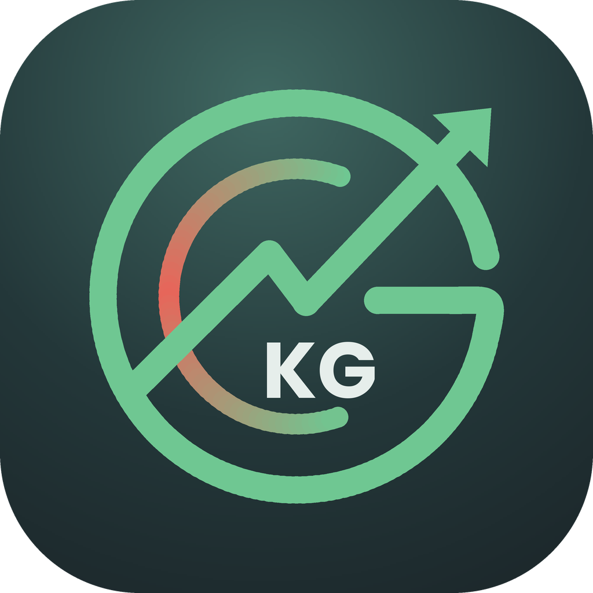

<p align="center">
  
</p>

<h1 align="center">AppGastos · Control de gastos e ingresos</h1>

<p align="center">
  App Android en Kotlin para registrar a mano gastos e ingresos y llevar un control nuevo cada mes.<br>
  Proyecto final de <b>Programación II</b> · Universidad Mariano Gálvez
</p>

**Autor:** Kervin Saul Garcia Rodriguez

---

## ¿Qué hace?

- **Registra gastos e ingresos** (salario, ventas, otros) con descripción, monto y fecha. No necesita login.
- **Categorías propias:** además de las 7 de fábrica, puedes crear las que quieras (por ejemplo, "Mascotas" 🐶).
- **Un control nuevo cada mes:** el mes sale de la fecha del movimiento. También hay vista **por año** y un **historial** mes por mes.
- **Balance con alerta:** si gastas más de lo que ingresa, la tarjeta se pone **roja** y llega una **notificación**.
- **Dólares:** registra en US$ y se convierte a quetzales con el **tipo de cambio del día** (API REST). Sin internet, se puede escribir a mano.
- **Estadísticas:** barras de ingresos vs gastos de 6 meses, comparación con el mes anterior y **proyección de fin de mes**.
- **Seguridad y privacidad:** PIN con pregunta secreta, huella o bloqueo del teléfono, y opción para ocultar los saldos.
- **Avisos:** recordatorio diario para anotar los gastos y alertas al llegar al 80 % o 100 % del límite de una categoría.
- **Los datos se guardan en SQLite**, así que no se pierden al cerrar la app.

## Cómo está organizado

El proyecto tiene **dos partes**:

| Parte | Qué es | Dónde está |
|---|---|---|
| **finanzas-core** (v1.0.1) | Librería Kotlin pura (sin Android): modelo, reglas del negocio y contratos de datos | `src/main/kotlin/...` y `pom.xml` (Maven) |
| **AppGastos** | La app de Android: pantallas, SQLite, notificaciones y seguridad | carpeta `app/` (Gradle) |

La app usa la librería a través de **interfaces** (patrón repositorio): para pasar de guardar en memoria a **SQLite** solo se cambió qué implementación se le entrega, sin tocar las reglas del negocio.

```
app/  (edu.umg.programacion2.appgastos)
├── datos/   SQLite y ajustes guardados
├── logica/  reglas de la app sin Android
├── avisos/  seguridad/  red/
└── ui/      principal · estadisticas · ajustes · comun
```

📄 La explicación completa está en **[ARQUITECTURA.md](ARQUITECTURA.md)**.

## Cómo correrla

1. **Instalar la librería** (la app la busca en la carpeta `.m2` de tu computadora).
   En IntelliJ: abrir el proyecto → pestaña **Maven** → `clean` → `install` (debe decir `BUILD SUCCESS`).
   O desde una terminal, en la raíz del repositorio: `mvn clean install`
2. Abrir el proyecto en **Android Studio**, sincronizar con `Ctrl + Shift + O` y presionar **▶ Run**.

Requisitos: Android 7.0 (API 24) o superior. Para el tipo de cambio hace falta internet.

## Descargar el APK

El `.apk` listo para instalar está en esta carpeta de Drive:
👉 [Carpeta de documentación y APK](https://drive.google.com/drive/folders/1ENN847MuNKEtkOFNexM_opj_tEOmGqAE?usp=sharing)

> Al instalarlo, Android puede pedir permiso para "instalar apps de origen desconocido", porque no viene de la Play Store.

## Tecnologías

Kotlin · Android (Views + XML) · SQLite · Corrutinas · API REST · Maven · Gradle
